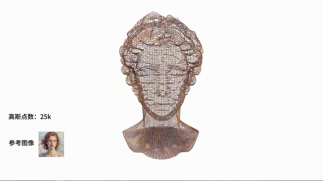
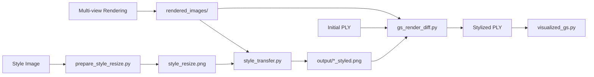

# 3D Gaussian Splatting Style Transfer


This project extracts **style features from a 2D reference image**, reconstructs a 3D model with **3D Gaussian Splatting (3DGS)**, and transfers the extracted style onto the **surface color of the 3D Gaussian model** — while keeping the geometry fixed.

The complete experimental pipeline: **multi-view rendering → 2D style transfer (Attention Distillation + CSGO) → differentiable 3DGS rasterization with joint color optimization**.

---

## Demo

**2D reference images (left) → stylized 3D Gaussian models (right):**



*Example excerpt (10 s loop, 720 px). Full demo video:*

<video src="assets/3DGS_demo.mp4" controls muted poster="assets/demo_poster.png" width="100%"></video>

**Video description:** The clip shows several 3D Gaussian models stylized from different reference images — a 25k-point face point cloud, a 500k-point abstract sculpture, a colorful textured vase, and a metallic bust — each paired with its reference image on the left.

> **Note:** the demo media files live in `assets/`. If they are missing from your checkout, download them from the repository release or re-render your own results and drop the files into `assets/` with the same names.

---

## Pipeline Overview



| Stage | Script | Input | Output |
|-------|--------|-------|--------|
| 0 | `prepare_style_resize.py` | any style image | `style_resize.png` (512×512 by default) |
| 1 | `blender_render_multiview.py` or `render_multiview_obj.py` | Blender scene / OBJ | `rendered_images/*.png` + `cameras.json` |
| 2 | `style_transfer.py` | rendered images + style image | `output/*_styled.png` |
| 3 | `gs_render_diff.py` | PLY + style images + cameras | stylized `.ply` |
| 4 | `visualized_gs.py` | PLY | Open3D window preview |

**Stage 3** uses the original [3D Gaussian Splatting](https://github.com/graphdeco-inria/gaussian-splatting) `diff_gaussian_rasterization` for **true differentiable rendering**: it randomly samples viewpoints, computes L1 loss against the stylized images, and updates **only the `f_dc_*` (color) parameters** of the PLY — the geometry stays fixed.

**Stage 2** runs two sequential 2D stylizers (no masks, whole-image transfer):
1. **Attention Distillation (AD)** with SD 1.5 — latent-space optimization for global style transfer;
2. **CSGO** with SDXL + Tile ControlNet + IP-Adapter — stronger refinement; BLIP auto-generates the caption.

Optionally, OpenCV **grabCut** estimates the foreground mask so the final composite keeps the original background and replaces only the foreground with the stylized result (`--no-object-mask` to skip).

---

## Installation

> All commands below are written for **Windows PowerShell**; adapt paths to your machine. The example paths (`D:\code\...`) are placeholders — use your own clone location and conda/Blender/VS install paths.

### Step 1 — Create a Conda environment

```powershell
conda create -n GSstyletransfer python=3.10 -y
conda activate GSstyletransfer
```

If `conda activate` fails with `CondaError: Run 'conda init' before 'conda activate'`:

- run `conda init powershell` and restart the terminal, **or**
- use the absolute Python path of your environment, e.g. `& "$env:USERPROFILE\anaconda3\envs\GSstyletransfer\python.exe" -m pip install ...`

### Step 2 — Install PyTorch (CUDA 12.8, required for RTX 50-series)

**RTX 50-series (Blackwell / sm_120) must use the cu128 build** — cu118 / cu124 fail with `no kernel image is available for execution on the device`. For other GPUs, pick the matching build on [pytorch.org](https://pytorch.org).

```powershell
pip install torch torchvision torchaudio --index-url https://download.pytorch.org/whl/cu128
```

Verify:

```powershell
python -c "import torch; print(torch.__version__, torch.cuda.is_available(), torch.cuda.get_device_name(0))"
```

### Step 3 — Install project dependencies

```powershell
cd <your-project-root>   # e.g. D:\code\3DGS-Style-Transfer
pip install -r requirements.txt
```

`requirements.txt` intentionally **does not include PyTorch** to avoid overriding your step-2 build. It covers: `diffusers==0.25.1`, `transformers==4.40.2`, `accelerate`, `safetensors`, `einops`, `huggingface-hub==0.24.5`, `numpy`, `Pillow`, `opencv-python`, `matplotlib`, `plyfile`, `open3d`, `trimesh`, `pyrender`, `PyOpenGL`, `imageio`, `tqdm`, `ninja`.

### Step 4 — Compile `diff-gaussian-rasterization` (required by Stage 3)

`gs_render_diff.py` depends on the differentiable rasterization extension, which must be compiled from source.

#### 4.1 System requirements

| Component | Recommended |
|---|---|
| NVIDIA driver | supporting CUDA 12.8 (or matching your PyTorch) |
| CUDA Toolkit | matching PyTorch (12.8 in this guide) |
| Visual Studio | **2022** (Community is fine; enable "Desktop development with C++") |
| ninja | installed via `pip install ninja` |

> Note: CUDA 12.8 does not officially support VS 2026. If you only have VS 2026, install VS 2022 Build Tools and point the compiler path to it (see 4.3).

#### 4.2 Make sure the source is present

The repo already contains `third_party/gaussian-splatting/submodules/diff-gaussian-rasterization`. If that directory is empty, from `third_party/gaussian-splatting` run:

```powershell
git submodule update --init --recursive submodules/diff-gaussian-rasterization
```

#### 4.3 Build and install

```powershell
conda activate GSstyletransfer
cd <project-root>\third_party\gaussian-splatting\submodules\diff-gaussian-rasterization

# If the system default is VS 2026, point to VS 2022 (adjust the path to your install):
# $env:DISTUTILS_USE_SDK = "1"
# $env:CXX = "C:\Program Files\Microsoft Visual Studio\2022\Community\VC\Tools\MSVC\<version>\bin\Hostx64\x64\cl.exe"

pip install . --no-build-isolation
```

If you get `ModuleNotFoundError: No module named 'torch'`, pip was building in an isolated environment — `--no-build-isolation` fixes it since your conda env already has torch.

Verify:

```powershell
python -c "from diff_gaussian_rasterization import GaussianRasterizer; print('OK')"
```

### Step 5 — Hugging Face mirror (optional, recommended in CN)

`style_transfer.py` defaults to `HF_ENDPOINT=https://hf-mirror.com`. You can also set it manually:

```powershell
$env:HF_ENDPOINT = "https://hf-mirror.com"
```

Stage 1 downloads `runwayml/stable-diffusion-v1-5`; Stage 2 downloads `Salesforce/blip-image-captioning-large`.

### Step 6 — Blender (only if you use the Blender renderer)

`blender_render_multiview.py` runs inside **Blender's own Python** (not the conda env). Install [Blender 3.x+](https://www.blender.org/) and make sure `blender` resolves in the terminal (or use the full path to `blender.exe`).

---

## Model Weights

These files are large and **not included** in the repository — download them manually:

### CSGO directory

| Path (relative to project root) | Description |
|---|---|
| `CSGO/csgo_4_32_v2.bin` | CSGO weights ([InstantX/CSGO](https://github.com/InstantX/CSGO)) |
| `CSGO/base_models/stable-diffusion-xl-base-1.0/` | SDXL Base |
| `CSGO/base_models/sdxl-vae-fp16-fix/` | SDXL VAE |
| `CSGO/base_models/TTPLanet_SDXL_Controlnet_Tile_Realistic/` | Tile ControlNet |
| `CSGO/base_models/IP-Adapter/sdxl_models/image_encoder/` | SDXL image encoder |

Download examples (Hugging Face CLI):

```powershell
pip install huggingface-hub
huggingface-cli download stabilityai/stable-diffusion-xl-base-1.0 --local-dir CSGO/base_models/stable-diffusion-xl-base-1.0
huggingface-cli download madebyollin/sdxl-vae-fp16-fix --local-dir CSGO/base_models/sdxl-vae-fp16-fix
huggingface-cli download TTPlanet/TTPLanet_SDXL_Controlnet_Tile_Realistic --local-dir CSGO/base_models/TTPLanet_SDXL_Controlnet_Tile_Realistic
huggingface-cli download h94/IP-Adapter --local-dir CSGO/base_models/IP-Adapter
huggingface-cli download InstantX/CSGO csgo_4_32_v2.bin --local-dir CSGO
```

### Data you need before running

| File / directory | Description |
|---|---|
| Style image | any image; sample `style_image/3.png` or your own |
| `style_resize.png` | generated by Stage 0 (written to the project root by default) |
| Initial 3DGS `.ply` | put into a directory you create (e.g. `3DGS_output/`); you can generate it from a mesh via `mesh2splat-main` |

---

## Usage

Run every command from the **project root**, with `conda activate GSstyletransfer` active.

### Stage 0 — Prepare the style image

```powershell
# default: reads style.png in the project root, writes style_resize.png
python prepare_style_resize.py

# recommended: specify your style image explicitly
python prepare_style_resize.py -i style_image/3.png -o style_resize.png
```

### Stage 1 — Multi-view rendering

**Option A — no Blender needed (recommended when you have an OBJ):**

```powershell
python render_multiview_obj.py house/model.obj
python render_multiview_obj.py path\to\your_model.obj --texture path\to\your_texture.png
```

The script auto-loads the UV texture → centers/normalizes → Fibonacci-samples viewpoints → writes `rendered_images/view_*.png` + `cameras.json`. It uses unlit shading (`defaultUnlit`) to preserve the original texture colors for later stylization.

**Option B — Blender scene:**

```powershell
blender --background path\to\your_scene.blend --python blender_render_multiview.py
```

Key settings (edit at the top of the script):

| Parameter | Default | Meaning |
|---|---|---|
| `CAMERA_LAYOUT` | `fibonacci` | uniform sphere sampling; alternatives: `multi_ring` / `legacy` |
| `NUM_VIEWS` | `32` | total views (fibonacci mode) |
| `MIN_ELEVATION_DEG` / `MAX_ELEVATION_DEG` | `5` / `75` | elevation range (deg; Z-up) |
| `RADIUS` | `3.0` | camera distance to target |

> After changing the layout or re-rendering, re-run Stages 2 and 3 (clear/overwrite `rendered_images/` and `output/` first).

### Stage 2 — Batch 2D style transfer

```powershell
python style_transfer.py --rendered-dir rendered_images --style style_resize.png --output output --limit 5 --hf-endpoint https://hf-mirror.com --no-object-mask
```

Internally:

1. **AD (Stage 2a):** SD 1.5 attention distillation for whole-image style transfer.
2. **CSGO (Stage 2b):** SDXL + ControlNet for further stylization; BLIP auto-generates the caption.
3. **Optional composite:** OpenCV grabCut estimates the foreground; the background is restored from the original render (`--no-object-mask` skips this).

Target throughput: roughly **8–10 minutes per image** (GPU-dependent, 16 views + default steps).

### Stage 3 — Differentiable 3DGS color optimization

```powershell
python gs_render_diff.py -i path\to\your_gaussians.ply -o path\to\your_gaussians_styled.ply --iterations 8000
```

Common parameters:

| Parameter | Default | Meaning |
|---|---|---|
| `--cameras-json` | `rendered_images/cameras.json` | camera parameters |
| `--styled-dir` | `output/` | stylized images (`*_styled.png`) |
| `--iterations` | `3000` | optimization iterations |
| `--lr` | `0.0025` | `f_dc` learning rate |
| `--reg-weight` | `0.01` | regularization toward original colors |
| `--lambda-dssim` | `0.0` | blend MSE weight (0 = pure L1) |

For ~200k points, 15 views, 3000 iterations, expect a few minutes depending on GPU. More iterations improve multi-view consistency, with linear time cost.

### Stage 4 — Visualize the PLY

```powershell
python visualized_gs.py path\to\your_gaussians_styled.ply
python visualized_gs.py path\to\before.ply path\to\after.ply
```

Open3D colors the point cloud by `f_dc_0/1/2` (approximate RGB). For photoreal viewing use a dedicated Gaussian Splatting viewer.

### One-shot check / run

```powershell
python run_pipeline.py --check       # check environment + data only
python run_pipeline.py --step 2      # run a single stage
python run_pipeline.py --obj house\model.obj   # run everything, rendering from an OBJ
```

---

## Repository Structure

```
3DGS-Style-Transfer/                # project root ($ROOT)
├── style_transfer.py               # Stage 2: batch AD + CSGO 2D stylization
├── prepare_style_resize.py         # Stage 0: style image preprocessing
├── blender_render_multiview.py     # Stage 1: Blender multi-view rendering
├── render_multiview_obj.py         # Stage 1 (alt): OBJ rendering without Blender
├── multiview_layout.py             # camera layout helpers
├── gs_render_diff.py               # Stage 3: differentiable 3DGS color optimization
├── gs_diff/                        # 3DGS camera/PLY utilities
├── visualized_gs.py                # Stage 4: Open3D preview
├── run_pipeline.py                 # one-shot checker/runner
├── requirements.txt
├── README.md
│
├── Attention Distillation/         # Stage 2a: SD 1.5 attention distillation
├── CSGO/                           # Stage 2b code; weights downloaded separately
├── third_party/gaussian-splatting/ # original 3DGS + diff-gaussian-rasterization
├── mesh2splat-main/                # mesh → Gaussian splat conversion
│
├── house/                          # [sample] OBJ mesh + texture
├── style_image/                    # [sample] style reference images (1.png … 8.png)
│
├── rendered_images/                # [generated] multi-view renders + cameras.json
├── output/                         # [generated] *_styled.png
├── 3DGS_output/                    # [generated] input/output PLYs (provide the input)
└── assets/                         # [generated] demo media (video / gif / poster)
```

**Bundled samples you can try right away:**

| Sample | Path |
|---|---|
| House mesh | `house/model.obj` + `house/texture.png` |
| Style images | `style_image/1.png` … `style_image/8.png` |

Weights, renders, and PLYs are **not** in the repo — download or generate them locally.

---

## `cameras.json`

Exported by the multi-view rendering scripts and read by `gs_render_diff.py` through `gs_diff/cameras.py`, which converts it into the 3DGS camera format. Root object contains a `frames` array; each frame has:

| Field | Meaning |
|---|---|
| `file` | image filename, e.g. `view_000.png` |
| `fx`, `fy`, `cx`, `cy` | pinhole intrinsics (pixels) |
| `width`, `height` | image resolution |
| `transform_matrix_c2w` | camera → world 4×4 matrix |
| `transform_matrix_w2c` | world → camera |

Internally the renderer coordinate system is converted to COLMAP / 3DGS conventions.

---

## FAQ

**`no kernel image is available for execution on the device`**

PyTorch and GPU architecture mismatch. On RTX 50-series reinstall the **cu128** build (see Step 2).

**`ModuleNotFoundError: No module named 'diff_gaussian_rasterization'`**

Stage 4 compilation is missing or CUDA/VS mismatch. Use VS 2022 + a matching CUDA Toolkit and re-run `pip install . --no-build-isolation`.

**`conda activate` fails**

Restart the terminal, or use the full path `...\envs\GSstyletransfer\python.exe`.

**Can't find `Attention Distillation` / `CSGO`**

Make sure `Attention Distillation/` and `CSGO/ip_adapter/` are at the project root.

**HuggingFace download timeout**

Set `$env:HF_ENDPOINT = "https://hf-mirror.com"` or pass `--hf-endpoint https://hf-mirror.com`.

**Missing `csgo_4_32_v2.bin`**

Download from [InstantX/CSGO](https://github.com/InstantX/CSGO) and place it in `CSGO/`.

**`gs_render_diff.py` can't find a stylized view**

Check that `output/` contains `{stem}_styled.png` for every `file` entry in `cameras.json`.

**Open3D install fails**

`open3d` is only needed for `visualized_gs.py` preview; it doesn't affect stylization or PLY updates.

---

## Sub-projects & References

- [`mesh2splat-main/README.md`](mesh2splat-main/README.md) — mesh → Gaussian splat conversion
- [`CSGO/README.md`](CSGO/README.md) — original CSGO repo notes
- CSGO paper: [Content-Style Composition in Text-to-Image Synthesis](https://arxiv.org/abs/2405.14026), [InstantX/CSGO](https://github.com/InstantX/CSGO)
- Differentiable rasterizer: [graphdeco-inria/gaussian-splatting](https://github.com/graphdeco-inria/gaussian-splatting)
- [Attention Distillation](https://github.com/JamesPerlman/AttentionDistillation)

> **Note:** This is a research prototype. Demo media are stored under `assets/`; all weights and intermediate results are generated locally.
