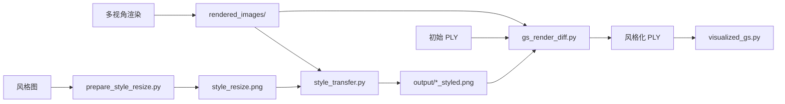

# 3D Gaussian Style Transfer Pipeline

多视角渲染 → 2D 风格迁移（Attention Distillation + CSGO）→ **可微 3DGS 光栅化**联合优化颜色的完整实验流水线。

> **路径与文件名说明**  
> 下文命令里的路径、文件名都是**示例**（或本仓库自带的样例数据）。请按你自己的机器与数据替换：
> - **项目根目录**：你 `git clone` 下来的本仓库路径（下文用 `$ROOT` 表示）。
> - **风格图 / 网格 / PLY**：换成你自己的文件名与相对路径。
> - **Conda / Blender / VS**：安装位置因人而异，不要照抄文档里的盘符示例。

---

## 流程概览



| 阶段 | 脚本 | 输入 | 输出 |
|------|------|------|------|
| 0 | `prepare_style_resize.py` | 任意风格图 | `style_resize.png`（默认 512×512） |
| 1 | `blender_render_multiview.py` 或 `render_multiview_obj.py` | Blender 场景 / OBJ | `rendered_images/*.png` + `cameras.json` |
| 2 | `style_transfer.py` | 渲染图 + 风格图 | `output/*_styled.png` |
| 3 | `gs_render_diff.py` | PLY + 风格图 + 相机 | 风格化后的 `.ply` |
| 4 | `visualized_gs.py` | PLY | Open3D 窗口预览 |

步骤 3 使用原版 [3D Gaussian Splatting](https://github.com/graphdeco-inria/gaussian-splatting) 的 `diff_gaussian_rasterization` 做**真实可微渲染**，随机采样视角、与风格图计算 L1 loss，仅更新 PLY 中的 `f_dc_*`（颜色），几何固定。

---

## 目录结构

```
3Dgs-style-transfer/          # 即项目根目录 $ROOT
├── style_transfer.py
├── prepare_style_resize.py
├── blender_render_multiview.py
├── render_multiview_obj.py
├── multiview_layout.py
├── gs_render_diff.py
├── gs_diff/
├── visualized_gs.py
├── run_pipeline.py
├── requirements.txt
├── README.md
│
├── Attention Distillation/   # 阶段一：SD1.5 注意力蒸馏
├── CSGO/                     # 阶段二代码；权重需自行下载（见下文）
├── third_party/gaussian-splatting/
├── mesh2splat-main/          # 网格 → 高斯泼溅
│
├── house/                    # [样例] OBJ 网格 + 贴图
├── style_image/              # [样例] 风格参考图
│
├── rendered_images/          # [运行产生] 多视角渲染 + cameras.json
├── output/                   # [运行产生] *_styled.png
└── 3DGS_output/              # [运行产生] 输入/输出 PLY（需自备初始 PLY）
```

**仓库自带样例（可直接改路径试用）：**

| 样例 | 路径 |
|------|------|
| 房屋网格 | `house/model.obj` + `house/texture.png` |
| 风格图 | `style_image/1.png` … `style_image/8.png` |

权重、渲染结果、PLY **不在** Git 仓库中，需本地下载或生成。

---

## 手动安装步骤

以下命令在 **PowerShell** 中执行。若 `conda activate` 报错，可直接使用你本机 Conda 环境的完整 Python 路径。

### 步骤 1：创建 Conda 环境

```powershell
conda create -n GSstyletransfer python=3.10 -y
conda activate GSstyletransfer
```

若出现 `CondaError: Run 'conda init' before 'conda activate'`：

1. 执行 `conda init powershell` 后**重启终端**；或
2. 用你机器上的绝对路径代替 activate，例如：

```powershell
# 路径按本机 Anaconda/Miniconda 安装位置修改
$PY = "$env:USERPROFILE\anaconda3\envs\GSstyletransfer\python.exe"
& $PY -m pip install ...
```

### 步骤 2：安装 PyTorch（CUDA 12.8，RTX 50 系必需）

**RTX 5070 等 Blackwell 显卡（sm_120）必须使用 cu128 版 PyTorch**，cu118 / cu124 会报 `no kernel image is available for execution on the device`。非 50 系可按 [PyTorch 官网](https://pytorch.org) 选择匹配的 CUDA 版本。

```powershell
pip install torch torchvision torchaudio --index-url https://download.pytorch.org/whl/cu128
```

验证：

```powershell
python -c "import torch; print(torch.__version__, torch.cuda.is_available(), torch.cuda.get_device_name(0))"
```

应看到 `True` 及你的 GPU 名称。

### 步骤 3：安装项目 Python 依赖

先进入**你 clone 下来的项目根目录**，再安装：

```powershell
cd <你的项目根目录>   # 例如: cd D:\code\3Dgs-style-transfer
pip install -r requirements.txt
```

`requirements.txt` **不包含** PyTorch，避免覆盖步骤 2 的版本。

### 步骤 4：编译 diff-gaussian-rasterization（步骤 3 必需）

`gs_render_diff.py` 依赖可微光栅化扩展，需从源码编译安装。

#### 4.1 系统要求

| 组件 | 推荐版本 |
|------|----------|
| NVIDIA 驱动 | 支持 CUDA 12.8（或与你的 PyTorch 匹配） |
| CUDA Toolkit | 与 PyTorch 一致（本文以 12.8 为例） |
| Visual Studio | **2022**（Community 即可，含「使用 C++ 的桌面开发」） |
| ninja | 已通过 `pip install ninja` 安装 |

> **注意**：CUDA 12.8 官方不支持 VS 2026。若只有 VS 2026，请额外安装 VS 2022 Build Tools，并在编译前指定其路径（见 4.3）。

#### 4.2 确认源码已就绪

本仓库已包含 `third_party/gaussian-splatting/submodules/diff-gaussian-rasterization`。若该目录为空，可在 `third_party/gaussian-splatting` 下执行：

```powershell
cd third_party/gaussian-splatting
git submodule update --init --recursive submodules/diff-gaussian-rasterization
```

#### 4.3 编译安装

```powershell
conda activate GSstyletransfer
cd <项目根目录>\third_party\gaussian-splatting\submodules\diff-gaussian-rasterization

# 若系统默认是 VS 2026，指定 VS 2022（路径按本机安装修改）：
# $env:DISTUTILS_USE_SDK = "1"
# $env:CXX = "C:\Program Files\Microsoft Visual Studio\2022\Community\VC\Tools\MSVC\<版本>\bin\Hostx64\x64\cl.exe"

pip install . --no-build-isolation
```

> **若报 `ModuleNotFoundError: No module named 'torch'`**  
> 这是 pip 默认在**隔离构建环境**里跑 `setup.py`，而 `setup.py` 需要 `import torch`。  
> 当前 Conda 里已有 torch 时，加上 **`--no-build-isolation`** 即可。

验证：

```powershell
python -c "from diff_gaussian_rasterization import GaussianRasterizer; print('OK')"
```

### 步骤 5：HuggingFace 镜像（可选，国内推荐）

`style_transfer.py` 默认使用 `HF_ENDPOINT=https://hf-mirror.com`。也可手动设置：

```powershell
$env:HF_ENDPOINT = "https://hf-mirror.com"
```

阶段一会下载 `runwayml/stable-diffusion-v1-5`；阶段二会下载 `Salesforce/blip-image-captioning-large`。

### 步骤 6：Blender（仅使用 Blender 渲染时需要）

`blender_render_multiview.py` 在 **Blender 自带 Python** 中运行，不依赖 Conda。请安装 [Blender 3.x+](https://www.blender.org/download/)，并保证终端里能运行 `blender`（或写上 blender.exe 的完整路径）。

---

## 模型权重准备

以下文件体积很大，**不会**随本仓库提供，需自行下载后放到对应目录：

### CSGO 目录

| 路径（相对项目根） | 说明 |
|------|------|
| `CSGO/csgo_4_32_v2.bin` | CSGO 权重（[InstantX/CSGO](https://huggingface.co/InstantX/CSGO)） |
| `CSGO/base_models/stable-diffusion-xl-base-1.0/` | SDXL Base |
| `CSGO/base_models/sdxl-vae-fp16-fix/` | SDXL VAE |
| `CSGO/base_models/TTPLanet_SDXL_Controlnet_Tile_Realistic/` | Tile ControlNet |
| `CSGO/base_models/IP-Adapter/sdxl_models/image_encoder/` | SDXL 图像编码器 |

### 运行前数据

| 文件 / 目录 | 说明 |
|-------------|------|
| 风格图 | 任选一张；可用样例 `style_image/3.png`，或自己的图片 |
| `style_resize.png` | 由步骤 0 生成（默认写在项目根目录） |
| 初始 3DGS `.ply` | 放到自建目录（如 `3DGS_output/`）；可用 mesh2splat 从网格生成 |

---

## 使用指南

以下命令均在**项目根目录**执行，且需已 `conda activate GSstyletransfer`。

```powershell
cd <你的项目根目录>
```

### 步骤 0：预处理风格图

```powershell
# 默认读取项目根目录下的 style.png，写出 style_resize.png
python prepare_style_resize.py

# 推荐：显式指定你的风格图（路径按实际修改）
python prepare_style_resize.py -i style_image/3.png -o style_resize.png
# python prepare_style_resize.py -i path\to\your_style.jpg -o style_resize.png
```

### 步骤 1：多视角渲染

**方式 A — 无需 Blender（有 OBJ 时推荐）**

```powershell
# 使用仓库样例网格
python render_multiview_obj.py house/model.obj

# 或换成你自己的 OBJ / 贴图
python render_multiview_obj.py path\to\your_model.obj --texture path\to\your_texture.png
```

脚本会：自动加载 UV 贴图 → 居中归一化 → fibonacci 采样多视角 → 输出 `rendered_images/view_*.png` + `cameras.json`。  
贴图使用无光照着色（`defaultUnlit`），保留贴图原始颜色，更适合后续风格迁移。

**方式 B — Blender 场景**

```powershell
# your_scene.blend 换成你的场景文件；blender 也可能需要写成完整路径
blender --background path\to\your_scene.blend --python blender_render_multiview.py
```

默认输出到 `rendered_images/`。脚本顶部可改：

| 参数 | 默认 | 说明 |
|------|------|------|
| `CAMERA_LAYOUT` | `fibonacci` | 球面均匀采样；可选 `multi_ring` / `legacy` |
| `NUM_VIEWS` | `32` | 视角总数（fibonacci 模式） |
| `MIN_ELEVATION_DEG` / `MAX_ELEVATION_DEG` | `5` / `75` | 仰角范围（度，Z 为上） |
| `RADIUS` | `3.0` | 相机到目标距离 |

输出文件名为 `view_000.png` …（`legacy` 模式仍为 `horizontal_*` / `vertical_*`）。

**更换布局或重渲后，需重新跑步骤 2、3**（清空或覆盖 `rendered_images/`、`output/` 后再执行）。

### 步骤 2：批量 2D 风格迁移

```powershell
python style_transfer.py
```

常用参数（目录名可按你的习惯改）：

```powershell
python style_transfer.py `
  --rendered-dir rendered_images `
  --style style_resize.png `
  --output output `
  --limit 5 `
  --hf-endpoint https://hf-mirror.com `
  --no-object-mask
```

**内部流程：**

1. **阶段一（AD）**：SD1.5 注意力蒸馏，整图风格迁移。
2. **阶段二（CSGO）**：SDXL + ControlNet 进一步风格化；BLIP 自动生成 caption。
3. **可选合成**：OpenCV grabCut 估计前景，背景换回原渲染图（`--no-object-mask` 跳过）。

### 步骤 3：可微光栅化优化 3DGS 颜色

`-i` / `-o` 换成你的初始 PLY 与输出路径：

```powershell
python gs_render_diff.py `
  -i path\to\your_gaussians.ply `
  -o path\to\your_gaussians_styled.ply `
  --iterations 8000
```

常用参数：

| 参数 | 默认 | 说明 |
|------|------|------|
| `--cameras-json` | `rendered_images/cameras.json` | 相机参数 |
| `--styled-dir` | `output/` | 风格图目录（`*_styled.png`） |
| `--iterations` | `3000` | 优化迭代次数 |
| `--lr` | `0.0025` | `f_dc` 学习率 |
| `--reg-weight` | `0.01` | 贴近原始颜色的正则 |
| `--lambda-dssim` | `0.0` | 混合 MSE 权重（0 = 纯 L1） |

约 20 万点、15 视角、3000 iter，视 GPU 而定通常需数分钟。

### 步骤 4：可视化 PLY

```powershell
python visualized_gs.py path\to\your_gaussians_styled.ply
python visualized_gs.py path\to\before.ply path\to\after.ply
```

Open3D 按 `f_dc_0/1/2` 近似 RGB 上色；照片级渲染请用 Gaussian Splatting 专用查看器。

### 可选：一键检查 / 运行

```powershell
python run_pipeline.py --check    # 只检查前置条件
python run_pipeline.py --step 2   # 只运行某一步
python run_pipeline.py            # 运行全部可执行步骤
```

`run_pipeline.py` 内对样例路径的检查同样是示例逻辑；缺文件时按提示改参数或补齐数据即可。

---

## 脚本索引

| 脚本 | 运行环境 | 作用 |
|------|----------|------|
| `prepare_style_resize.py` | Conda | 风格图缩放到 512×512 |
| `render_multiview_obj.py` | Conda | OBJ 多视角渲染（无需 Blender） |
| `blender_render_multiview.py` | Blender Python | 环绕渲染 + 导出 `cameras.json` |
| `style_transfer.py` | Conda + GPU | 多视角 AD → CSGO 批量风格迁移 |
| `gs_render_diff.py` | Conda + CUDA + diff_gaussian_rasterization | 可微渲染联合优化 PLY 颜色 |
| `visualized_gs.py` | Conda | Open3D 点云预览 |

---

## `cameras.json` 说明

由多视角渲染脚本导出，`gs_render_diff.py` 通过 `gs_diff/cameras.py` 读取并转换为 3DGS 相机格式。根对象含 `frames` 数组，每帧主要字段：

| 字段 | 含义 |
|------|------|
| `file` | 图片文件名，如 `view_000.png` |
| `fx`, `fy`, `cx`, `cy` | 针孔内参（像素） |
| `width`, `height` | 图像分辨率 |
| `transform_matrix_c2w` | 相机 → 世界 4×4 矩阵 |
| `transform_matrix_w2c` | 世界 → 相机 |

`gs_diff` 内部会将渲染坐标系转换为 COLMAP / 3DGS 约定。

---

## 性能参考

`style_transfer.py` 目标约 **10 分钟/张**（视 GPU 而定）。加速时可减小 `num_inference_steps`、降低 AD 分辨率等，详见脚本内默认参数。

`gs_render_diff.py` 每 iter 随机选一视角渲染并反传，迭代越多多视角一致性越好，耗时线性增长。

---

## 常见问题

**`no kernel image is available for execution on the device`**

PyTorch 版本与 GPU 架构不匹配。RTX 50 系请重装 **cu128** 版 PyTorch（见安装步骤 2）。

**`ModuleNotFoundError: No module named 'diff_gaussian_rasterization'`**

未完成步骤 4 编译，或编译时 CUDA / VS 版本不兼容。请用 VS 2022 + 匹配的 CUDA Toolkit 重新 `pip install . --no-build-isolation`。

**`conda activate` 失败**

重启终端，或使用本机 `...\envs\GSstyletransfer\python.exe` 完整路径。

**找不到 Attention Distillation / CSGO**

确认 `Attention Distillation/` 与 `CSGO/ip_adapter/` 位于项目根目录。

**HuggingFace 下载超时**

设置 `$env:HF_ENDPOINT = "https://hf-mirror.com"` 或 `--hf-endpoint https://hf-mirror.com`。

**缺少 `csgo_4_32_v2.bin`**

从 [InstantX/CSGO](https://huggingface.co/InstantX/CSGO) 下载，放到 `CSGO/` 根目录。

**`gs_render_diff.py` 找不到某视角的风格图**

检查风格图目录中是否存在对应 `{stem}_styled.png`（stem 与 `cameras.json` 中 `file` 一致）。

**Open3D 安装失败**

`open3d` 仅用于 `visualized_gs.py` 预览，不影响风格迁移与 PLY 更新。

---

## 子项目

- [`mesh2splat-main/README.md`](mesh2splat-main/README.md) — 网格转高斯泼溅
- [`CSGO/README.md`](CSGO/README.md) — CSGO 原仓库说明

---

## 引用

若使用 CSGO，请参考 [CSGO 论文](https://arxiv.org/abs/2404.02733) 与 [InstantX/CSGO](https://huggingface.co/InstantX/CSGO)。  
3DGS 可微光栅化来自 [graphdeco-inria/gaussian-splatting](https://github.com/graphdeco-inria/gaussian-splatting)。
